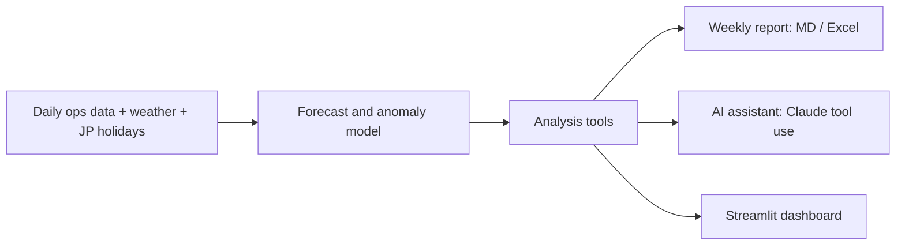
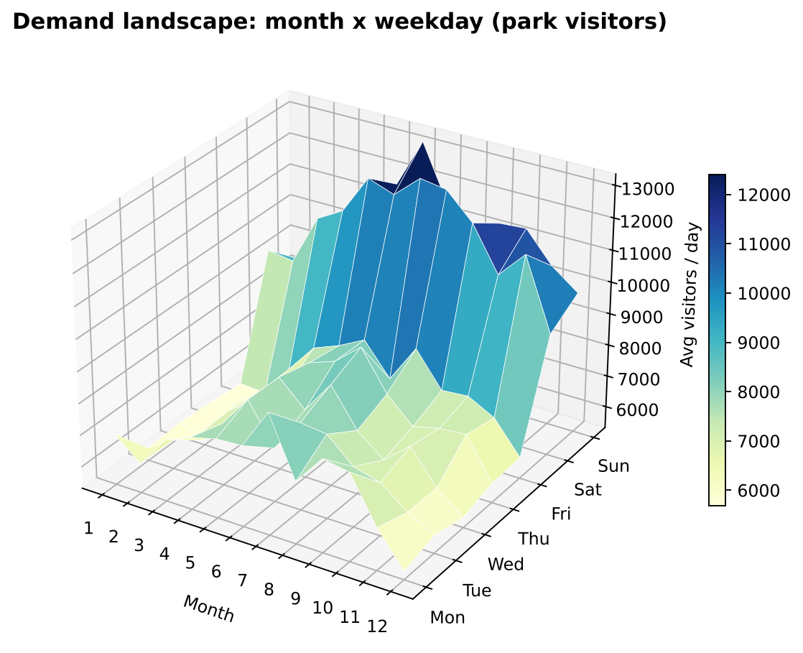
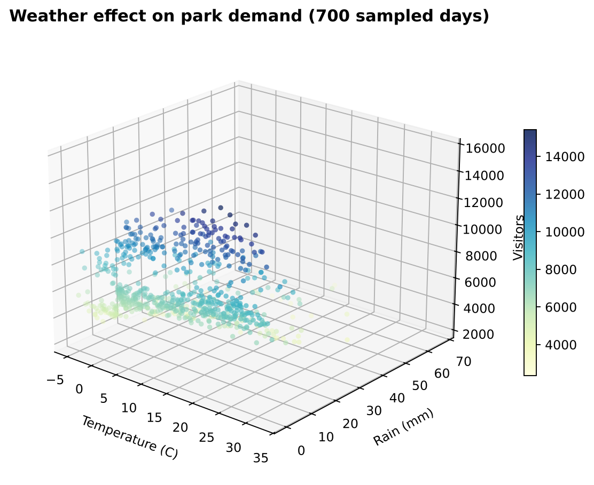
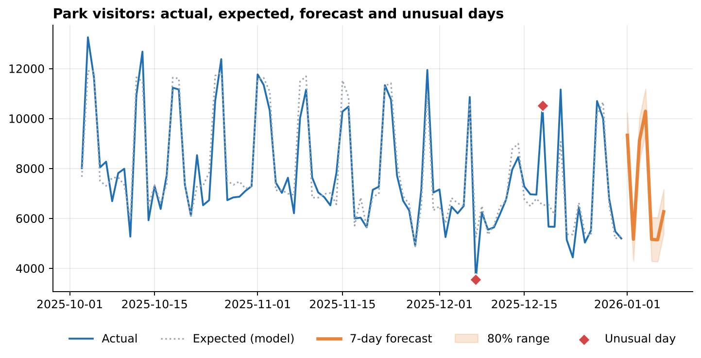
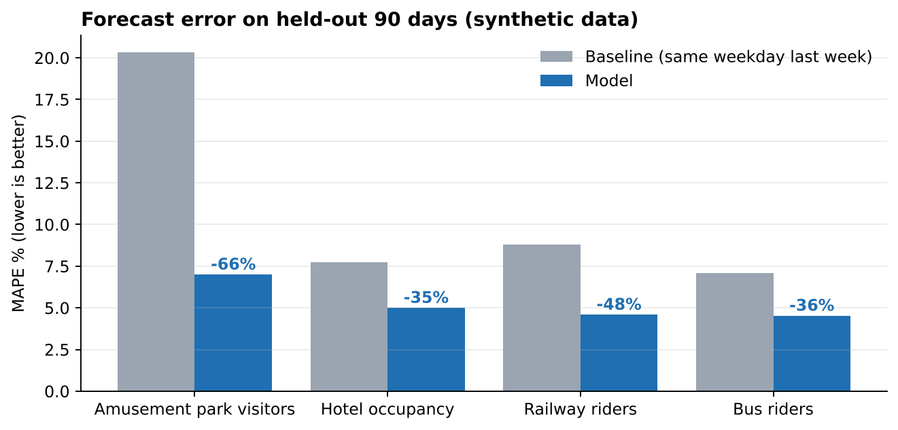

# 🚃 Daily Ops Insight Assistant

> A small-scale DX pilot for a tourism and transport group: **find a frontline problem → prototype → measure → improve.**

Built as a portfolio project for an IT Generalist (DX) role. It turns daily railway, bus, park and hotel numbers into
a **7-day forecast, automated weekly reports and a data-grounded AI assistant**, with the pilot measured against a baseline.

| | |
|---|---|
| **Forecast** | 35-66% lower error than "same weekday last week" on a held-out 90 days |
| **Anomalies** | 83% of hidden event days found (83% precision) |
| **Reporting** | Weekly report (Markdown + Excel, EN/JA) in one command |
| **AI agent** | JA/EN Q&A via Claude tool use; every number comes from tools |

> All data is synthetic. Metrics show the method works, not real-world performance. See `docs/evaluation_results.md`.

## Architecture


## Renders
| | |
|---|---|
|  |  |
|  |  |

Regenerate with `python -m src.render_figures`. The dashboard has an interactive version of the 3D views (tab **3D explorer**).

## What it does
| Step | Module | Output |
|---|---|---|
| Data | `src/generate_data.py` | 3 years of daily visitors, occupancy, ridership + weather + JP holidays |
| Forecast | `src/analysis.py` | 7-day forecast with 80% range, backtest vs naive baseline |
| Anomalies | `src/analysis.py` | Days far from what calendar and weather predict |
| Automation | `src/report.py` | Weekly report (Markdown + Excel, EN/JA) in one command |
| AI agent | `src/agent.py` | JA/EN Q&A via Claude tool use; offline fallback with no key |
| Dashboard | `app.py` | Streamlit UI tying everything together |
| Evaluation | `src/evaluate.py` | Auto-generated `docs/evaluation_results.md` |

## Quick start
```bash
pip install -r requirements.txt
python -m src.generate_data        # creates data/daily_ops.csv (optional; auto-created if missing)
streamlit run app.py               # dashboard + assistant (or: make run)
python -m src.report --lang ja     # weekly report to reports/
python -m src.evaluate             # pilot metrics to docs/evaluation_results.md
pytest                             # tests
```
Enable the LLM agent: `export ANTHROPIC_API_KEY=...` (optional `OPS_AGENT_MODEL`, default `claude-sonnet-5-5`).

## Design decisions
- **The agent never does arithmetic or recalls numbers.** Every figure comes from a tool; the LLM only chooses tools and phrases the answer.
- **Honest baselines.** The forecast is compared with "same weekday last week" on a held-out 90 days.
- **Unexplained is allowed.** If calendar and weather can't explain a spike, the agent says so and points to frontline staff.
- **Hidden event days** in the synthetic data are never given to the model; they only validate the anomaly detector.
- **Security by design:** aggregates only, no personal data, key via environment variable.

## Project layout
```
app.py  src/{generate_data,analysis,report,agent,evaluate,config,calendar_jp}.py
docs/{requirements,interview_guide,evaluation_results}.md  tests/  reports/  data/
```

## Next steps (real-world)
Real data connectors · weather forecast feed · user authentication · hourly granularity · frontline feedback loop · rollout plan.
